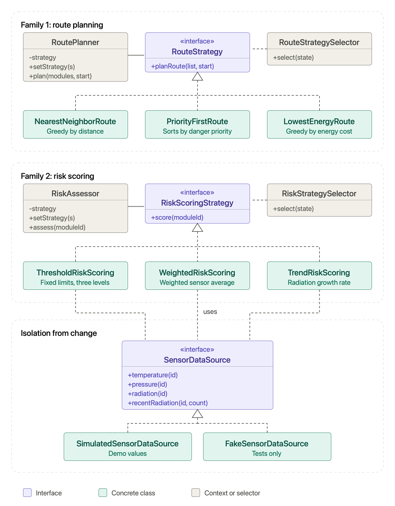

# Space Station Inspection Robot: Strategy Pattern

Assignment 5, Software Design Patterns.
Author: Khanzada
Domain: Space Station Inspection Robot (same domain as Assignment 4).

An inspection robot moves between modules of a space station.
It plans the order in which modules are visited and scores how dangerous each module is.
Both operations can be done in several ways, so both are built with the Strategy pattern.

## 1. What the program does

| Family | Question it answers | Strategies |
|---|---|---|
| Route planning | In which order should the robot visit modules? | `NearestNeighborRoute`, `PriorityFirstRoute`, `LowestEnergyRoute` |
| Risk scoring | How dangerous is one module right now? | `ThresholdRiskScoring`, `WeightedRiskScoring`, `TrendRiskScoring` |

Each family has one interface, three strategies, one context, and one selector.

| Family | Interface | Context | Selector |
|---|---|---|---|
| Route planning | `RouteStrategy` | `RoutePlanner` | `RouteStrategySelector` |
| Risk scoring | `RiskScoringStrategy` | `RiskAssessor` | `RiskStrategySelector` |

## 2. How each strategy works

| Strategy | Logic |
|---|---|
| `NearestNeighborRoute` | Always goes to the closest unvisited module (greedy by distance). |
| `PriorityFirstRoute` | Sorts modules by danger priority, highest first; equal priority goes to the closer module. |
| `LowestEnergyRoute` | Always takes the cheapest next step: travel energy plus hatch opening energy. |
| `ThresholdRiskScoring` | Compares radiation, temperature, pressure with fixed limits; returns 10, 60, or 100. |
| `WeightedRiskScoring` | Normalizes the three readings to 0..1 and mixes them with weights 50%, 30%, 20%. |
| `TrendRiskScoring` | Uses the latest radiation value (60%) plus how fast the last five readings grow (40%). |

Every strategy has different logic, not only different numbers.

## 3. Context rules

`RoutePlanner` and `RiskAssessor` follow the same pattern:

- the strategy is passed in the constructor
- `setStrategy()` replaces it while the program runs
- the work is delegated to the strategy

The contexts contain no `if`, `switch`, or `instanceof`.

## 4. Selectors

Selectors choose a strategy from the current station state (`StationState`).
Rules are checked from top to bottom, the first match wins.
`if` is used only in selectors, because choosing is their job.

**RouteStrategySelector**

| Priority | Condition | Chosen strategy |
|---|---|---|
| 1 | Alarm is active | `PriorityFirstRoute` |
| 2 | Battery is below 20% | `LowestEnergyRoute` |
| 3 | Anything else | `NearestNeighborRoute` |

**RiskStrategySelector**

| Priority | Condition | Chosen strategy |
|---|---|---|
| 1 | Radiation storm | `ThresholdRiskScoring` |
| 2 | Routine inspection | `WeightedRiskScoring` |
| 3 | Anything else | `TrendRiskScoring` |

## 5. Isolation from change (Clean Code, Chapter 10)

The risk strategies need sensor data such as temperature, pressure, and radiation.
They never talk to a real sensor.
They depend only on our own interface `SensorDataSource`.
This is the same idea as `PortfolioManager` and `StockExchange` in the lecture.

| Implementation | Where | Purpose |
|---|---|---|
| `SimulatedSensorDataSource` | main code | Repeatable pseudo-random values for the demo (the seed is a constructor argument) |
| `FakeSensorDataSource` | tests | Fixed values, so every test gives the same result on every run |

A real sensor feed can be added as a new class without any change in the strategies.

## 6. Project structure

```
src/main/java/spacerobot/
  Main.java
  model/        StationModule, StationState
  datasource/   SensorDataSource, SimulatedSensorDataSource
  route/        RouteStrategy, three strategies, RoutePlanner, RouteStrategySelector
  risk/         RiskScoringStrategy, three strategies, RiskAssessor, RiskStrategySelector, RiskMath
src/test/java/spacerobot/
  FakeSensorDataSource
  RiskScoringBehaviorTest
  ThresholdRiskScoringTest, WeightedRiskScoringTest, TrendRiskScoringTest
  RouteStrategiesTest, RoutePlannerTest
  RouteStrategySelectorTest, RiskStrategySelectorTest
  AllStrategiesParameterizedTest
```

## 7. Classes and responsibilities

| Class | Responsibility |
|---|---|
| `StationModule` | Describes one station module: position, danger priority, hatch energy cost. |
| `StationState` | Holds current station conditions: battery level, alarm flag, radiation storm flag, routine inspection flag. |
| `SensorDataSource` | Defines how the program reads temperature, pressure, radiation readings from any sensor feed. |
| `SimulatedSensorDataSource` | Produces repeatable pseudo-random sensor readings for the demo. |
| `FakeSensorDataSource` | Returns fixed sensor readings so tests give the same result every run. |
| `RouteStrategy` | Declares the contract for planning an inspection route through station modules. |
| `NearestNeighborRoute` | Plans a route by always visiting the closest unvisited module next. |
| `PriorityFirstRoute` | Plans a route by visiting modules from highest to lowest danger priority. |
| `LowestEnergyRoute` | Plans a route by repeatedly choosing the cheapest step, travel energy plus hatch energy. |
| `RoutePlanner` | Holds a route strategy, accepts replacements, delegates planning to the current strategy. |
| `RouteStrategySelector` | Chooses a route strategy from the station state: alarm flag, battery level. |
| `RiskScoringStrategy` | Declares the contract for scoring the danger level of one module. |
| `ThresholdRiskScoring` | Scores risk with fixed limits that jump straight to warning or danger values. |
| `WeightedRiskScoring` | Scores risk as a weighted average of radiation, temperature, pressure readings. |
| `TrendRiskScoring` | Scores risk from the latest radiation reading plus how fast recent readings rise. |
| `RiskAssessor` | Holds a scoring strategy, accepts replacements, delegates scoring to the current strategy. |
| `RiskStrategySelector` | Chooses a risk scoring strategy from the station state: radiation storm, routine inspection. |
| `RiskMath` | Provides the shared clamp helper that limits values to the range zero to one. |
| `Main` | Runs the console demo comparing strategies, selectors, runtime switching. |

## 8. UML diagram



Dashed lines with a hollow triangle mean "implements".
A solid arrow means "delegates to".
A dashed arrow means "creates" (from a selector) or "uses" (from a strategy to the data source).

## 9. Why this is Strategy and not State or Template Method

**Not State.**
In the State pattern an object changes its behavior when its own internal state changes.
The states know each other and trigger the transitions themselves, so the context moves from one state to the next.
Nothing like this happens here.
`RoutePlanner` and `RiskAssessor` never change their strategy by themselves.
A strategy does not know about the other strategies and never touches the context.
The choice always comes from outside: from the client (manual choice) or from a selector (automatic choice).
The strategies are also independent alternatives for the same job, not steps of a life cycle.
`NearestNeighborRoute` and `PriorityFirstRoute` solve the same problem in different ways,
and no rule says that one of them must follow the other.

**Not Template Method.**
Template Method fixes the skeleton of an algorithm in a base class
and lets subclasses override single steps through inheritance.
The variant is chosen at compile time, because the subclass is the algorithm.
Here the whole algorithm is replaced, not one step of it.
Planning a route by distance, by priority, or by energy has no shared skeleton.
The variants are separate classes behind an interface and are linked to the context by composition.
The context can swap them at runtime with `setStrategy()`.
The demo shows this: the same `RoutePlanner` object returns a different route after the strategy is replaced.

**Open/Closed Principle.**
A new algorithm is a new class that implements the interface.
Neither the context nor the existing strategies change.
Only the selector needs one new rule, and only if the new strategy must be chosen automatically.

## 10. Refactoring with Git history (risk scoring family)

First the risk scoring was written the "bad" way:
one class `LegacyRiskAssessor` held all three algorithms and chose between them with `switch` on an enum `RiskMode`.
Then it was refactored into the Strategy pattern.

| Commit | Description | Link |
|---|---|---|
| Before | All three algorithms in `LegacyRiskAssessor`, chosen with `switch` | https://github.com/nyshanbekovakhan-glitch/assignment5_SDP/commit/aebf03723004602607c584312ee9216da69257a1 |
| After | Strategy interface, three strategy classes, `RiskAssessor` context, legacy class deleted | https://github.com/nyshanbekovakhan-glitch/assignment5_SDP/commit/763b4ff8235201bc30c3761b5f8872aa062bb869 |
The same 7 tests in `RiskScoringBehaviorTest` pass on both commits.
They have identical expected values.
Only the private helper `score(...)` inside the test changed, because the way of creating the object changed.

## 11. Tests (JUnit 5)

| Test class | What it checks |
|---|---|
| `RiskScoringBehaviorTest` | 7 behavior tests, identical on the before commit and the after commit |
| `ThresholdRiskScoringTest` | Danger level, warning level, safe level of the threshold strategy |
| `WeightedRiskScoringTest` | Each weight separately, clamping of extreme values |
| `TrendRiskScoringTest` | One reading, fast growth, falling values |
| `RouteStrategiesTest` | The three route strategies give three different orders on the same modules |
| `RoutePlannerTest` | `setStrategy()` changes the result at runtime |
| `RouteStrategySelectorTest` | Every route rule, rule priority, battery boundary at 20% |
| `RiskStrategySelectorTest` | Every risk rule, rule priority |
| `AllStrategiesParameterizedTest` | `@ParameterizedTest`: risk score stays in 0..100 for all risk strategies, every route visits each module exactly once for all route strategies |

All tests that need sensor data use `FakeSensorDataSource`.
In total 41 test runs pass.

## 12. How to run

Requirements: Java 17 or newer and Maven.

```
mvn test
mvn compile exec:java -Dexec.mainClass=spacerobot.Main
```

The demo prints four blocks:

1. The same modules processed by all route strategies
2. Manual choice and automatic choice by `RouteStrategySelector` (three situations)
3. The same module scored by all risk strategies
4. Automatic choice by `RiskStrategySelector` and a runtime switch with `setStrategy()`

## 13. How to extend

| Goal | What to do |
|---|---|
| New route algorithm | Create a class that implements `RouteStrategy`, for example `SafestRoute`. No other class changes. |
| New automatic rule | Add one `if` in the selector and one test for it. |
| New data source | Create a class that implements `SensorDataSource`. No strategy changes. |
